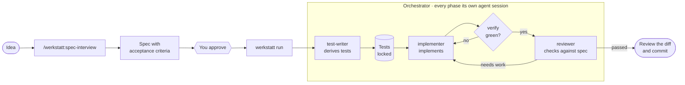

<div align="center">

# werkstatt

**Spec-driven development with coding agents – with guardrails that hold.**

You decide *what* gets built. Agents build it.
Locked acceptance tests and an independent review make sure that what comes out is what the spec says.

[](LICENSE)
[](https://github.com/niklas-enns/werkstatt/releases)
[](https://code.claude.com/docs/en/plugins)

</div>

---

*Werkstatt* is German for workshop.

## Why?

Coding agents write code fast. Everything around it is the hard part:

- **What exactly should be built?** Implicit knowledge, edge cases and business rules rarely make it into the ticket.
- **Is the result right?** An agent that writes its own tests likes to confirm itself – and when in doubt, it changes the test instead of the code.
- **Who checks?** Humans can't keep up with reading generated code.

werkstatt is the harness around the agent that closes these gaps: spec first, tests before code and locked against changes, deterministic checks outside the model, and a review with fresh eyes.

## How it works



1. **Specify** – In an interview, an agent asks you about rules, edge cases, error cases and the interface until every acceptance criterion is unambiguously testable.
2. **Approve** – Only you set a spec to `approved`.
3. **Let it be implemented** – `werkstatt run` does the rest on its own:
   - The **test-writer** turns each acceptance criterion into an executable test. The tests are **locked**.
   - The **implementer** implements. It can't stop until `verify` is green – and it can't change the locked tests.
   - The **reviewer** checks the change independently against the spec and conventions. If something is wrong, its findings go into another round.
4. **Decide** – If the spec leaves something open, werkstatt asks you in the terminal at the end. Your decision is recorded in the spec.

Everything werkstatt and its agents produce is in English – the interview, specs, tests and reviews.

## What's inside

| Component | Kind | Job |
|---|---|---|
| `project-init` | Skill | Sets up a project: `AGENTS.md`, `werkstatt.json`, directories for specs and acceptance tests – in an empty directory also the project skeleton |
| `spec-interview` | Skill | Turns a rough idea into a testable spec by interviewing you |
| `test-writer` | Agent | Derives black-box acceptance tests from the spec, one per criterion |
| `implementer` | Agent | Implements the spec until the locked tests are green |
| `reviewer` | Agent | Checks the implementation against the spec and `AGENTS.md`, with a structured verdict |
| Hooks | Hooks | Lock acceptance tests against changes, require a green `verify` from the implementer |
| `werkstatt run` | Orchestrator (TypeScript, [Claude Agent SDK](https://code.claude.com/docs/en/agent-sdk)) | Drives the phases, checks for itself, retries, asks, keeps a log |

## Quick start

### 1. Install the plugin

In Claude Code:

```
/plugin marketplace add niklas-enns/werkstatt
/plugin install werkstatt@werkstatt
```

### 2. Install the orchestrator

```bash
git clone https://github.com/niklas-enns/werkstatt.git
cd werkstatt/orchestrator
npm install && npm run build && npm link
```

The `werkstatt` command is then available everywhere. The orchestrator uses your Claude Code login or `ANTHROPIC_API_KEY` and loads the agents and hooks from its own checkout.

### 3. Get going

In the target project, in Claude Code:

```
/werkstatt:project-init
/werkstatt:spec-interview A person creates a poll to find a date, with several proposed dates
```

Read the spec, set `status: approved` in its front matter, commit. Then, in a terminal:

```bash
werkstatt run 001
```

## The orchestrator in detail

```
werkstatt run <spec-id> [--attempts 2] [--budget <usd>] [--max-turns 150] [--model <id>] [--allow-dirty]
```

| Step | What happens | Who checks |
|---|---|---|
| Preconditions | Spec is `approved`, working tree is clean | Orchestrator |
| Acceptance tests | `test-writer` writes tests (file name contains `Spec<number>`) and reports which test checks which criterion – or stops if the spec isn't testable | Orchestrator: tests exist and are locked |
| Implementation | `implementer` implements | Stop hook: `verify` green (sends it back up to three times) · Orchestrator: tests unchanged, `verify` green |
| Review | `reviewer` delivers `PASSED` / `NEEDS_WORK`, findings and open questions | Orchestrator evaluates the structured verdict |
| Rework | Blocking findings become the task for the next round | until `--attempts` is reached |
| Open questions | In the terminal: **keep**, **decide differently** or **later** – decisions are recorded in the spec's "Decisions" section | you |

werkstatt never commits. Every run is logged to `.werkstatt/state/runs/` – phases, cost, turns and outcome as JSON, plus each review as a readable Markdown file.

The agent sessions run without asking: file tools, the verify command and read-only shell and git commands are allowed – everything else is denied.

## The spec format

A spec is a Markdown file `docs/specs/NNN-<slug>.md` with front matter (`id`, `title`, `status: draft | approved`, `depends-on`) and the sections Goal, Terms, Rules, Interface, Acceptance criteria, Out of scope and Open questions. Each acceptance criterion has an ID (`AC-1`, …) and the form **Given** / **When** / **Then** with concrete values. The template is [`skills/spec-interview/spec-template.md`](skills/spec-interview/spec-template.md).

## Protecting the acceptance tests

The hooks are active as soon as the plugin is loaded and the project has a `werkstatt.json` – also when you work with Claude Code interactively.

| Hook | Effect |
|---|---|
| `PreToolUse` | Denies writes to locked acceptance tests, `.werkstatt/` and `werkstatt.json` – including obvious detours through the shell (`rm`, `sed -i`, redirections …) |
| `Stop` | Restores changed locked tests from the locked copy and locks new test files. In the implementation phase, `verify` must also be green – after three rejections the session may end anyway, since the orchestrator checks for itself |

Only humans can unlock:

```bash
werkstatt status              # show locked acceptance tests
werkstatt unlock Spec001      # unlock tests whose path contains "Spec001"
```

Good to know:

- **Unlock first, then change.** If you change a locked test by hand, the next stop hook silently restores it – even if you made the change in your editor.
- **Unlocking is temporary.** After `unlock`, the next stop hook locks the test again with its then-current content. That's how you fix a wrong test: unlock, change, carry on.
- **To have tests derived again:** unlock *and* delete the files. As long as a spec has tests, `werkstatt run` skips the test-writer phase.

`.werkstatt/locks/` belongs in the repository, so the locks apply to everyone. `.werkstatt/state/` ignores itself.

## Configuration

`project-init` creates a `werkstatt.json` in the project:

```json
{
  "version": 1,
  "specs": "docs/specs",
  "acceptanceTests": "src/test/java/com/example/acceptance",
  "commands": {
    "verify": "./mvnw verify",
    "run": "./mvnw quarkus:dev"
  }
}
```

Context and conventions for the agents live in the project's `AGENTS.md`.

## Requirements and limits

**Requirements**
- [Claude Code](https://code.claude.com) with plugin support
- Node.js ≥ 20 (orchestrator), Python ≥ 3.9 (hooks), git
- In the target project: **one** command that builds and runs all tests

**A good fit** for backend and service projects whose behaviour can be tested from the outside through an interface (HTTP, CLI, public API).

**Not a good fit yet** for
- UI-heavy applications, data analysis or infrastructure code – the "acceptance test against an interface" pattern fits worse there
- several specs in progress at once – werkstatt works through one spec after the other
- decisions changed after the review: they are implemented and reviewed, but not backed by new acceptance tests

## Project structure

```
werkstatt/
├── .claude-plugin/     plugin and marketplace manifest
├── skills/             project-init, spec-interview
├── agents/             test-writer, implementer, reviewer
├── hooks/              acceptance test lock, verify gate
├── orchestrator/       werkstatt run (TypeScript, Claude Agent SDK)
└── tests/              tests for the hooks
```

Run the tests:

```bash
python3 -m unittest discover tests      # hooks
cd orchestrator && npm test             # orchestrator
```

## Status

werkstatt is an early experiment (v0.1). The workflow works end to end on a sample project, but interfaces and file formats may still change. Feedback and issues are welcome.

Planned: analysis of the run logs (cost, attempts, review findings across several runs).

## License

[Apache License 2.0](LICENSE)
