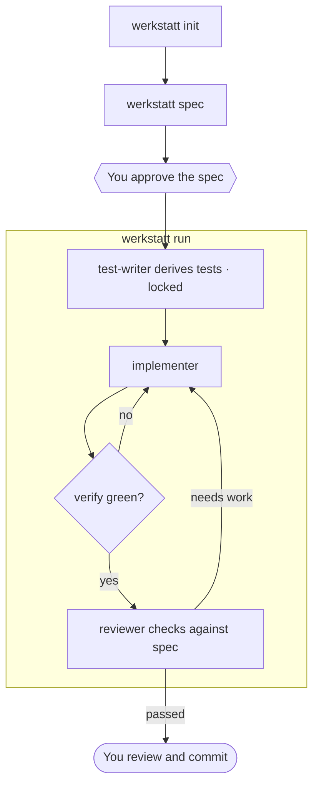

<div align="center">

# werkstatt

**Spec-driven development with coding agents – with guardrails that hold.**

You decide *what* gets built. Agents build it.
Locked acceptance tests and an independent review make sure that what comes out is what the spec says.

[](LICENSE)
[](https://github.com/niklas-enns/werkstatt/releases)
[](https://code.claude.com/docs/en/agent-sdk)

</div>

---

*Werkstatt* is German for workshop.

## Why?

Coding agents write code fast. Everything around it is the hard part:

- **What exactly should be built?** Edge cases and business rules rarely make it into the ticket.
- **Is the result right?** An agent that writes its own tests likes to confirm itself – and when in doubt, it changes the test instead of the code.
- **Who checks?** Humans can't keep up with reading generated code.

werkstatt closes these gaps: spec first, tests before code and locked against changes, deterministic checks outside the model, and a review with fresh eyes.

## How it works



1. **`werkstatt init`** – the *initializer* sets up the project once: it finds out stack, verify command and structure, asks about the rest, and writes `AGENTS.md` and `werkstatt.json`.
2. **`werkstatt spec`** – the *interviewer* asks about rules, edge cases and the interface until every acceptance criterion is testable. It can only write specs, never approve them.
3. **You approve** – only you set a spec to `status: approved`.
4. **`werkstatt run`** – the *test-writer* turns each criterion into a test, which is then locked. The *implementer* works until `verify` is green, without being able to touch the locked tests. The *reviewer* checks the result against the spec; its findings go into another round. Questions the spec leaves open are asked in the terminal at the end, and your answers are recorded in the spec.

### Why a CLI and not Claude Code?

You don't ask Claude Code to follow a process – `werkstatt` runs the process and hands each step to an agent. The guardrails only hold if the model doesn't control them:

- **The order is code.** Tests come before the implementation and the review before the end because the orchestrator runs them that way – no step can be skipped.
- **Every phase is a fresh session.** The reviewer doesn't see how the implementer argued for its solution.
- **Checks run outside the model.** Locks, the `verify` gate and the check for changed tests are TypeScript, not instructions an agent can talk itself out of.

The price is a plainer interface: the interview runs in the terminal, without your usual Claude Code setup.

## Quick start

```bash
git clone https://github.com/niklas-enns/werkstatt.git
cd werkstatt/orchestrator
npm install && npm run build && npm link
```

`werkstatt` uses your Claude Code login or `ANTHROPIC_API_KEY`. Then, in the target project:

```bash
werkstatt init
werkstatt spec "A person creates a poll to find a date, with several proposed dates"
# read the spec, set status: approved, commit
werkstatt run 001
```

## Commands

All commands work in the current directory; `--project <dir>` points them at another one. `init`, `spec` and `run` also take `--budget <usd>`, `--max-turns <n>` (default 150) and `--model <id>`.

**`werkstatt init [description]`** – In an empty directory it first generates a skeleton with the stack's official generator. It never replaces an existing file; shell commands that change something need your approval (`y`, `a` for always, `n` or a reason). Afterwards werkstatt checks the setup, runs `verify` and offers to commit.

**`werkstatt spec <idea>`** – Answer a question with an option's number or in your own words; when the interviewer hands over, ask for changes or press Enter to finish. A write that sets `status: approved` is denied.

**`werkstatt run <spec-id> [--attempts 2] [--allow-dirty]`**

| Step | What happens | Who checks |
|---|---|---|
| Preconditions | Spec is `approved`, working tree is clean, locked tests are unchanged | Orchestrator |
| Acceptance tests | `test-writer` writes tests (file name contains `Spec<number>`), maps them to criteria – or stops if the spec isn't testable. Skipped if the spec already has tests | Orchestrator: tests exist and are locked |
| Implementation | `implementer` implements | Stop hook and orchestrator: `verify` green, tests unchanged |
| Review | `reviewer` delivers `PASSED` / `NEEDS_WORK`, findings and open questions | Orchestrator evaluates the verdict |
| Rework | Blocking findings become the next round's task | until `--attempts` is reached |
| Open questions | **keep**, **decide differently** or **later** – recorded under "Decisions" in the spec | you |

`run` never commits and doesn't ask anything during its sessions: file tools, `verify` and read-only shell and git commands are allowed, everything else is denied. Each run is logged to `.werkstatt/state/runs/` (phases, cost, turns, outcome, and each review as Markdown).

**`werkstatt status`** / **`werkstatt unlock <pattern>`** – see below.

## The spec format

A spec is a Markdown file `docs/specs/NNN-<slug>.md` with front matter (`id`, `title`, `status`, `depends-on`) and the sections Goal, Terms, Rules, Interface, Acceptance criteria, Out of scope and Open questions – see [`templates/spec-template.md`](templates/spec-template.md). Each criterion has an ID (`AC-1`, …) and the form **Given** / **When** / **Then** with concrete values.

The format is werkstatt's own, not a formal standard. The criteria borrow Given / When / Then from BDD but aren't Gherkin: the test-writer turns them into tests in the project's own framework, so the spec only has to be unambiguous, not executable.

## Locked acceptance tests

In every session, a `PreToolUse` hook denies writes to locked tests, `.werkstatt/` and `werkstatt.json` – including obvious shell detours (`rm`, `sed -i`, redirections …). In `run`, a `Stop` hook also restores changed locked tests and locks new ones, and in the implementation phase it requires a green `verify` (after three rejections it gives in – the orchestrator checks anyway).

Only humans can unlock:

```bash
werkstatt status              # show locked acceptance tests
werkstatt unlock Spec001      # unlock tests whose path contains "Spec001"
```

- **To fix a test:** unlock, change it, run again – `run` locks it with the new content. If you change a locked test without unlocking, `run` refuses to start.
- **To have tests derived again:** unlock *and* delete them.

Commit `.werkstatt/locks/` so the locks apply to everyone; `.werkstatt/state/` ignores itself.

## Configuration

`werkstatt.json`, written by `init`:

```json
{
  "version": 1,
  "specs": "docs/specs",
  "acceptanceTests": "src/test/java/com/example/acceptance",
  "commands": {
    "verify": "./mvnw verify",
    "run": "./mvnw quarkus:dev"
  }
}
```

Context and conventions for the agents live in the project's `AGENTS.md`.

## Requirements and limits

- Node.js ≥ 20, git, and a Claude login or `ANTHROPIC_API_KEY`
- In the target project: **one** command that builds and runs all tests

werkstatt fits backend and service projects whose behaviour can be tested from the outside (HTTP, CLI, public API). It fits worse for UI-heavy applications, data analysis or infrastructure code. It works through one spec at a time, and decisions changed after the review are implemented and reviewed but not backed by new acceptance tests.

## Development

`agents/` holds the agent prompts, `templates/` the templates for spec, `AGENTS.md` and `werkstatt.json`, `orchestrator/` the `werkstatt` command. Tests: `cd orchestrator && npm test`.

## Status

An early experiment (v0.2): the workflow works end to end on a sample project, but interfaces and file formats may still change. Feedback and issues are welcome.

**Upgrading from 0.1:** the Claude Code plugin is gone – `/werkstatt:project-init` and `/werkstatt:spec-interview` are now `werkstatt init` and `werkstatt spec`. Run `/plugin uninstall werkstatt@werkstatt`, then pull and rebuild the orchestrator. Existing locks keep working.

## License

[Apache License 2.0](LICENSE)
